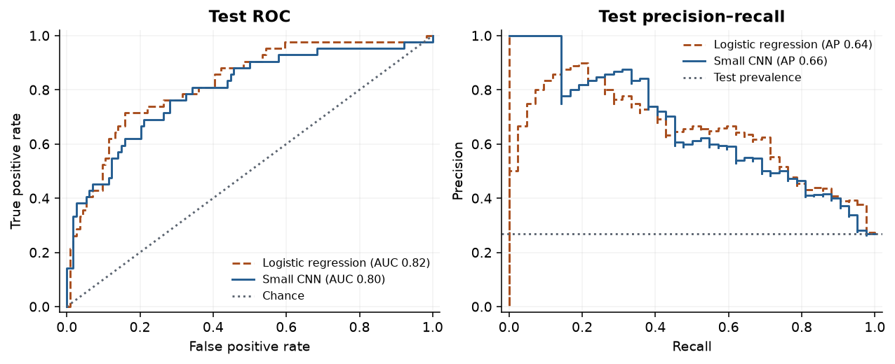

# BreastMNIST ultrasound classification

A small PyTorch project that asks whether a convolutional neural network improves on logistic regression for ranking malignant breast ultrasound images in the 28 × 28 BreastMNIST benchmark.

## Results

The table reports one CPU run with seed 42 on the official test set of **156 images, 42 labeled malignant**. Sensitivity, specificity, balanced accuracy, and accuracy use a fixed score threshold of 0.5.

| Model | ROC AUC | Average precision | Accuracy | Balanced accuracy | Malignant sensitivity | Specificity |
| --- | ---: | ---: | ---: | ---: | ---: | ---: |
| Majority class | 0.500 | 0.269 | 0.731 | 0.500 | 0.000 | 1.000 |
| Logistic regression | **0.824** | 0.641 | **0.795** | **0.679** | **0.429** | 0.930 |
| Small CNN | 0.799 | **0.660** | 0.769 | 0.586 | 0.190 | 0.982 |

Logistic regression had higher ROC AUC and flagged 18 of 42 malignant images. The CNN had slightly higher average precision and flagged 8 of 42. Its confusion matrix shows **34 false negatives and 2 false positives**. The majority-class baseline achieved 73.1% accuracy while missing all 42 malignant images.

[All metrics, including validation and the duplicate-exclusion check](results/metrics.csv) · [Learning curves](results/training_curves.png) · [CNN confusion matrix](results/confusion_matrix.png) · [Training history](results/training_history.csv)

## Data and methods

BreastMNIST is derived from the Breast Ultrasound Images (BUSI) dataset. It contains 780 grayscale images with official train, validation, and test sizes of 546, 78, and 156. The source benchmark merges normal and benign images into one class. The notebook remaps the labels so malignant is the positive class for all reported metrics. [MedMNIST paper](https://doi.org/10.1038/s41597-022-01721-8) · [BUSI paper](https://doi.org/10.1016/j.dib.2019.104863)

The majority baseline scores all images with the training prevalence. Logistic regression uses 784 pixel intensities scaled to [0, 1]. The CNN uses two convolution and pooling blocks followed by a linear output. It trains for 15 epochs with Adam, a learning rate of 0.001, and a batch size of 32. Validation ROC AUC selects the checkpoint. Epoch 14 was selected with validation AUC 0.795. Logistic regression's validation AUC was 0.844.

## Split audit and limitations

The notebook finds one pixel-identical pair across training and test with conflicting labels. The main results above retain the official split. Excluding that test row with both models frozen gave ROC AUC of 0.829 for logistic regression and 0.805 for the CNN. Malignant sensitivity was unchanged for both models because the excluded test row had a normal-or-benign label.

The audit checks exact pixel matches. Verifying near duplicates and patient-level independence requires additional information. Image downsampling, the small test set, and the single training seed limit what this experiment establishes. Generalization to other scanners or hospitals would need separate evaluation.

## Reproduce in Colab

1. Download [breastmnist_colab.ipynb](breastmnist_colab.ipynb) and upload it via **File → Upload notebook** in [Google Colab](https://colab.research.google.com/).
2. Connect to a hosted CPU and choose **Runtime → Run all**. The notebook downloads the official data and verifies its checksum.
3. The last cell regenerates the tables and figures in `results/`.

The saved outputs were generated locally on CPU with Python 3.14.6, PyTorch 2.15.0, scikit-learn 1.9.0, NumPy 2.4.6, pandas 3.0.3, and Matplotlib 3.11.0. The notebook prints the active versions on each run.

The notebook's example thumbnails are grayscale renderings of BreastMNIST images from the official MedMNIST release, distributed under CC BY 4.0. [Official dataset and attribution](https://zenodo.org/records/10519652) · [CC BY 4.0 license](https://creativecommons.org/licenses/by/4.0/)
